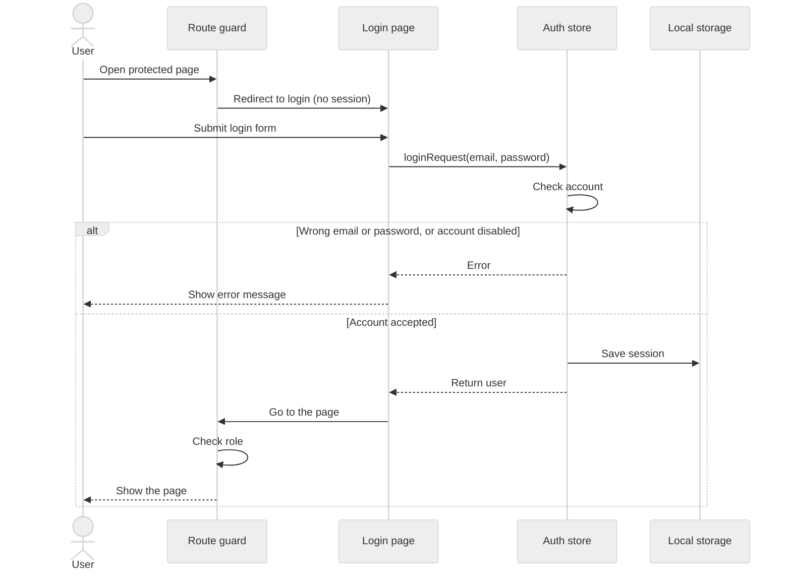

# Figure A-2: Sequence diagram, log in

Requirements: FR-07 (log in), NFR-07 (protected pages need a signed-in user). Picture for the SRS: `images/login.png`.

Notes
- In the current build the auth store and the session are in the browser. With the backend, "Auth store" becomes `POST /auth/login` on the Backend API and "Local storage" holds the token.
- A signed-in user with the wrong role is sent away from the page by the route guard (check this against the `requireAuth` code).
