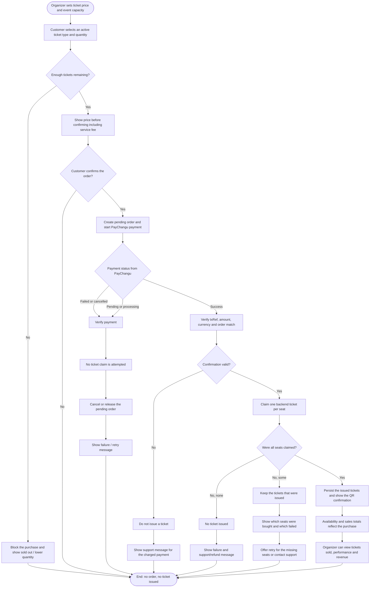

# Ticket Types, Booking & Payments

This document covers the purchase and payment flow for a customer, plus the
organizer controls that determine what can be bought. It is the diagram set for
requirements `FR-09` to `FR-14`, `FR-32`, `FR-33`, `FR-35`, `FR-37`, `NFR-06`
and `NFR-09`.

## Preconditions set by the organizer

- The organizer creates publishes an event with a maximum capacity (`FR-33`).
- The organizer sets or updates the price of each ticket type (`FR-32`).
- A ticket type is only purchasable while it is active, inside its sales window,
  and while it has remaining quantity.
- The backend is the source of truth for stock. A ticket is claimed only after
  the payment has been confirmed and verified; the application does not issue a
  ticket, or reduce availability, before that point (`NFR-09`).

## Sequence diagram: buy a ticket, including rollback on payment failure

```mermaid
sequenceDiagram
    autonumber
    actor Customer
    participant UI as Checkout UI
    participant Pay as PayChangu
    participant PayAPI as Payment adapter
    participant TicketAPI as Ticket backend
    participant DB as Backend database

    Customer->>UI: Open event and choose ticket type and quantity
    UI->>TicketAPI: GET /events/:eventId/ticket-types
    TicketAPI-->>UI: Active ticket types, price, quantity and remaining
    UI->>UI: Check remaining quantity (FR-09, FR-13)
    alt Not enough tickets remaining
        UI-->>Customer: Show "sold out" / reduce quantity, block purchase
    else Tickets available
        UI-->>Customer: Show ticket price subtotal, service fee and total (FR-10, NFR-06)
        Customer->>UI: Confirm order (FR-11)
        UI->>UI: Save pending payment with txRef, user, event, ticket type and quantity
        UI->>Pay: Start PayChangu checkout
        Pay-->>Customer: Payment prompt / checkout page
        Customer->>Pay: Pay or cancel

        alt Payment fails, is cancelled, or remains unconfirmed
            Pay-->>UI: Return with failed/pending status
            UI->>PayAPI: Verify payment by txRef
            PayAPI-->>UI: failed / pending
            UI->>UI: Cancel the pending order; do not call ticket issuance
            UI-->>Customer: Show failure, no ticket issued, availability unchanged (NFR-09)
        else Payment succeeds
            Pay-->>UI: Return with success status and txRef
            UI->>PayAPI: Verify payment by txRef
            PayAPI->>Pay: Verify amount, reference and currency
            Pay-->>PayAPI: Confirmed payment details
            alt Reference, currency or amount does not match the order
                PayAPI-->>UI: Reject confirmation
                UI-->>Customer: Show support message; no ticket issued (NFR-09)
            else Verified payment
                loop Once per seat in the order
                    UI->>TicketAPI: POST /tickets/purchase { eventId, ticketTypeId }
                    TicketAPI->>DB: Lock ticket type row and find an unassigned ISSUED ticket
                    alt No ticket available or sales are closed
                        DB-->>TicketAPI: No stock
                        TicketAPI-->>UI: 400 sold out / sales closed
                        UI->>UI: Stop claiming more seats
                    else Ticket available
                        TicketAPI->>DB: Assign ticket to customer and increment quantity_sold (FR-14)
                        TicketAPI-->>UI: ticketNumber + QR code containing qrToken
                        UI->>UI: Save issued ticket locally for confirmation and My Tickets
                    end
                end
                alt All seats issued
                    UI-->>Customer: Confirm purchase and show digital ticket + QR (FR-12)
                    TicketAPI->>DB: Sales and attendance data updated (FR-35, FR-37)
                else Some seats issued
                    UI-->>Customer: Show purchased tickets and list the seats that failed
                    Note over UI,Customer: Payment succeeded, so support/refund is needed for the missing seats.
                else No seats issued
                    UI-->>Customer: Show failure and support message; no ticket was issued
                end
            end
        end
    end
```

## Activity diagram: payment success versus failure, all branches



## Requirement traceability

| Requirement | Where it is covered |
| --- | --- |
| `FR-09` Select an available ticket | Customer chooses an active ticket type with remaining stock; the backend re-checks stock when claiming. |
| `FR-10` Show price before confirming | Price, quantity, service fee and total are shown before the customer confirms. |
| `FR-11` Purchase a ticket | Confirmed, verified payment triggers one backend claim per seat. |
| `FR-12` Confirm successful purchase | The confirmation page shows issued tickets and their QR images. |
| `FR-13` Block purchase at capacity | The remaining-quantity check blocks the purchase before payment; the backend also refuses a claim when no ticket is available. |
| `FR-14` Update availability after purchase | The backend increments `quantity_sold` when it claims a ticket; the UI refreshes events and tickets after success. |
| `FR-32` Organizer sets/updates ticket prices | Organizer ticket-type management supplies the price used throughout checkout. |
| `FR-33` Organizer sets max tickets for event | Event capacity and ticket-type quantity limit what can be claimed. |
| `FR-35` Organizer views tickets sold | Issued tickets and ticket-type sales are visible in organizer reporting. |
| `FR-37` Organizer sees performance and revenue | Confirmed purchases feed the organizer sales and revenue views. |
| `NFR-06` Price on selection and confirmation | Both the checkout selection screen and the confirmation flow display the amount. |
| `NFR-09` Never oversell; ticket only after confirmed purchase | No ticket is claimed before payment verification; the backend locks stock during the claim and refuses exhausted ticket types. |
